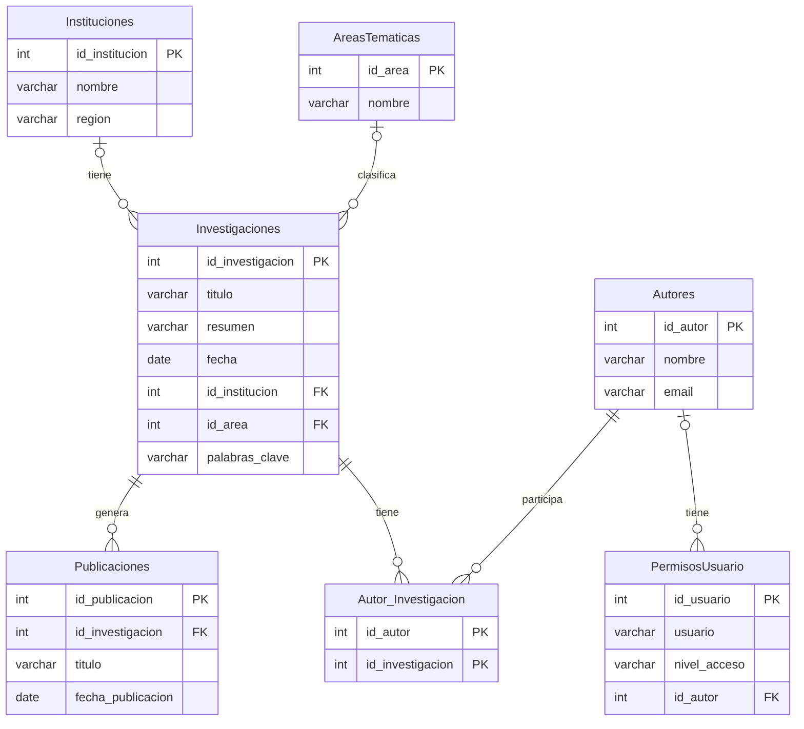

# Investigaciones científicas: SQL Server y Python

Base de datos relacional en **SQL Server** para registrar investigaciones científicas, sus autores, instituciones, áreas temáticas y publicaciones, con una aplicación de consola en **Python (pyodbc)** para consultarla y modificarla. Incluye también un modelo documental (JSON) del mismo dominio, para comparar ambos enfoques.

## Qué muestra este proyecto
- Diseño de un modelo relacional con claves primarias, claves foráneas, restricciones `CHECK` y borrado en cascada.
- Relación muchos a muchos entre autores e investigaciones (`Autor_Investigacion`).
- Consultas SQL con `JOIN`, `LEFT JOIN`, `GROUP BY`, `HAVING`, subconsultas y una vista.
- Conexión a SQL Server desde Python con consultas parametrizadas y manejo de transacciones (`commit` y `rollback`).
- Comparación entre el modelo relacional y un modelo de documentos.

## Modelo de datos



## Archivos

| Archivo | Contenido |
|---|---|
| `01_crear_tablas.sql` | Crea la base de datos y las tablas. Se puede ejecutar varias veces sin duplicar nada. |
| `02_datos_ejemplo.sql` | Datos de ejemplo inventados. Solo inserta si las tablas están vacías. |
| `03_consultas.sql` | Consultas de ejemplo y una vista (`vw_resumen_investigaciones`). |
| `investigaciones.py` | Aplicación de consola en Python con menú. |
| `modelo_documental.json` | El mismo dominio modelado como un documento JSON. |
| `requirements.txt` | Dependencias de Python. |

## Cómo ejecutarlo

**Requisitos:** SQL Server (por ejemplo, la edición Express), SQL Server Management Studio, [ODBC Driver 18 for SQL Server](https://learn.microsoft.com/sql/connect/odbc/download-odbc-driver-for-sql-server) y Python 3.

1. En SQL Server Management Studio ejecuta, en este orden, `01_crear_tablas.sql`, `02_datos_ejemplo.sql` y, si quieres, `03_consultas.sql`.
2. Instala la dependencia de Python:
   ```
   pip install -r requirements.txt
   ```
3. Indica tu servidor. Por defecto usa `localhost\SQLEXPRESS`. En PowerShell, para otro nombre:
   ```
   $env:DB_SERVER = "MI-EQUIPO\SQLEXPRESS"
   ```
   También puedes cambiar `DB_NAME` (base de datos) y `DB_DRIVER` (driver ODBC).
4. Ejecuta el programa:
   ```
   python investigaciones.py
   ```

La conexión usa la autenticación de Windows y no guarda usuarios ni contraseñas.

## Modelo relacional frente a modelo documental
`modelo_documental.json` guarda una investigación completa en un solo documento, con sus autores, área y publicaciones anidados. En el modelo relacional esa información se reparte en siete tablas relacionadas.

- **Ventaja del modelo documental:** una sola lectura trae toda la investigación.
- **Ventaja del modelo relacional:** no repite datos (cada institución y cada autor se guardan una sola vez) y las claves foráneas garantizan la integridad.
- **Diferencia de diseño:** en el JSON la institución pertenece a cada autor; en el modelo relacional pertenece a la investigación.

## Posibles mejoras
- Procedimientos almacenados para las operaciones de inserción y borrado.
- Índices sobre las columnas de búsqueda más frecuentes.
- Usar la tabla `PermisosUsuario` para controlar quién puede modificar datos.
- Mover la institución a una relación autor-institución, como en el modelo documental.
